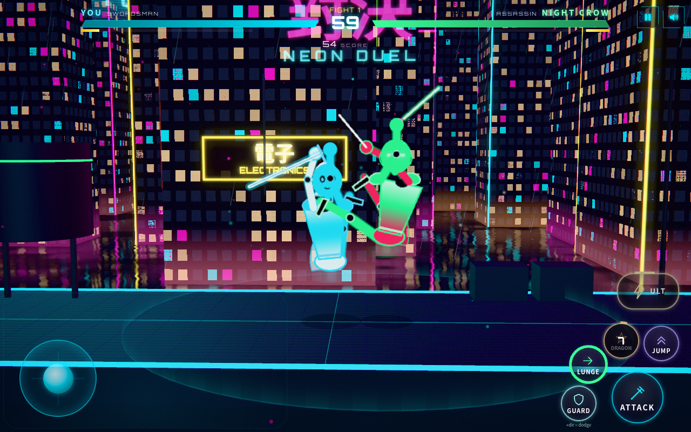

# 霓虹對打 NEON STICK DUEL

> 賽博迷你格鬥 · cyber mini Street Fighter / KOF · 人形霓虹角色 · Hitstop · 挑空 · 清楚招式 · 階梯十連戰 + 無盡天台塔

**作者 Author:** 嘉豐  

> **Product split 2026-10-25:** 機甲雷台 is a **standalone Google Play fighter** (SF/KOF-style, heavy sprites, landscape, two-hand) — **not** a one-hand casual hub snack. Hub stays short cyberpunk mini-games. See [`docs/PRODUCT-SPLIT.md`](docs/PRODUCT-SPLIT.md) · [`AGENT.md`](AGENT.md).

**試玩 Play:** https://fung2222.github.io/neon-stick-duel/ · **自動示範 Demo:** https://fung2222.github.io/neon-stick-duel/?demo=1



## 玩法 How to play
揀職業，用左邊**虛擬搖桿**自由走位，右邊好似手掣：大**攻擊**掣連段，防禦／技能／跳圍住，**必殺**係上面長掣。

| 掣 | 動作 |
|---|---|
| **攻擊** ATTACK | 連撳出 3–4 下連段；挑空之後跳起可以接空中連段 |
| **技能 1／2** | 每個職業兩招技能，有冷卻光圈 |
| **必殺** ULT | 打中或者被打都會儲能量，儲滿放必殺技（有特寫） |
| **跳** JUMP · **防禦** GUARD | 空中再撳跳＝**二段跳**；按住防禦；防禦＋方向＝閃避 |

| 職業 | 造型 | 技能 1 | 技能 2 | 必殺 |
|---|---|---|---|---|
| 劍士 Swordsman | 劍、長褸 | 疾風突刺 | 昇龍斬（挑空） | 千刃斬 |
| 魔法師 Mage | 法杖、長袍 | 閃現 | 雷柱 | 星隕天降 |
| 拳師 Brawler | 拳套、頭帶 | 火箭衝拳 | 震地拳 | 百裂拳 |
| 刺客 Assassin | 雙匕首、面罩 | 影步飛刀 | 瞬殺 | 死蓮 |

**階梯模式**：十場（第 5、10 場頭目）。**無盡天台塔**：無限層，每 10 層頭目。被 K.O. 可**原地復活**一次（網頁版免費）。

## 手感 Feel
- **Hitstop** — 命中凍結 3–8 幀，重擊／挑空更長  
- **Launch** — 昇龍／昇天拳／震地等清楚挑空，可接空中連段  
- **Readable attacks** — 蓄勢 → 出招 → 收招剪影分明，主動幀有揮砍弧線  

## 語言 Language
**繁體中文（香港）**／**English**（主畫面或暫停「EN／中」；`?lang=en` / `?lang=zh`）。

## 鍵盤 Keyboard
`A` `D` / `←` `→` 走位 · `W` / `↑` / `Space` 跳 · `S` / `↓` 防禦 · `Shift` 閃避 · `J` 攻擊 · `K` `L` 技能 · `U` 必殺 · `P` / `Esc` 暫停 · `M` 靜音

## 網址參數 URL flags
`?demo=1` · `?cls=mage&floor=12` · `?fps=1` · `?quality=low` · `?adsim=1` · `?reset=1` · `?mute=1` · `?bloom=0.4` · `?lang=en`

## 技術 Tech
自動橫向（`screen.orientation.lock` + iOS CSS rotate fallback，見 `docs/ORIENTATION.md`）· Three.js billboards + [cyber-kit](https://github.com/fung2222/cyber-kit) v0.3 · 純模擬 `js/duel.js`（固定 1/60 s）· 程序繪製人形霓虹精靈 `js/sprite/human.js` · 冇 build step。

## 開發 Development
```bash
python3 -m http.server 8811
node tests/duel.test.mjs
node tests/sprite.test.mjs
node tests/balance.mjs 1000 0.7
python tests/smoke.py http://127.0.0.1:8811/ docs/shots
```

屬於 [CYBER ARCADE](https://github.com/fung2222/cyber-arcade) 系列 · 作者 **嘉豐**。
